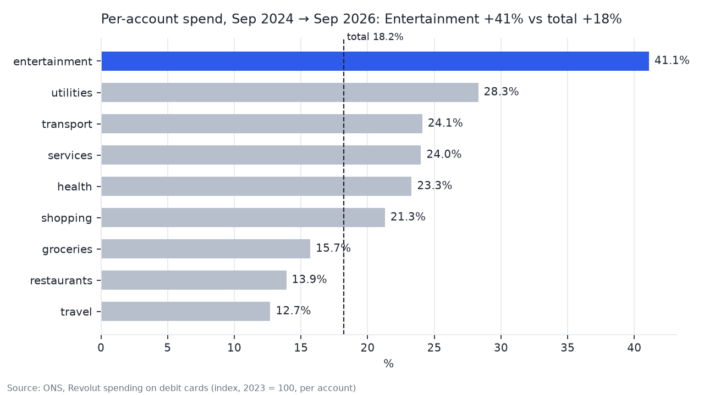
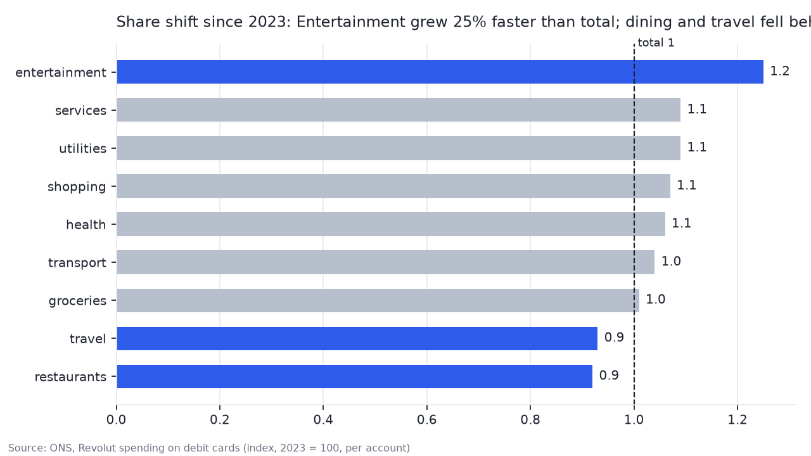
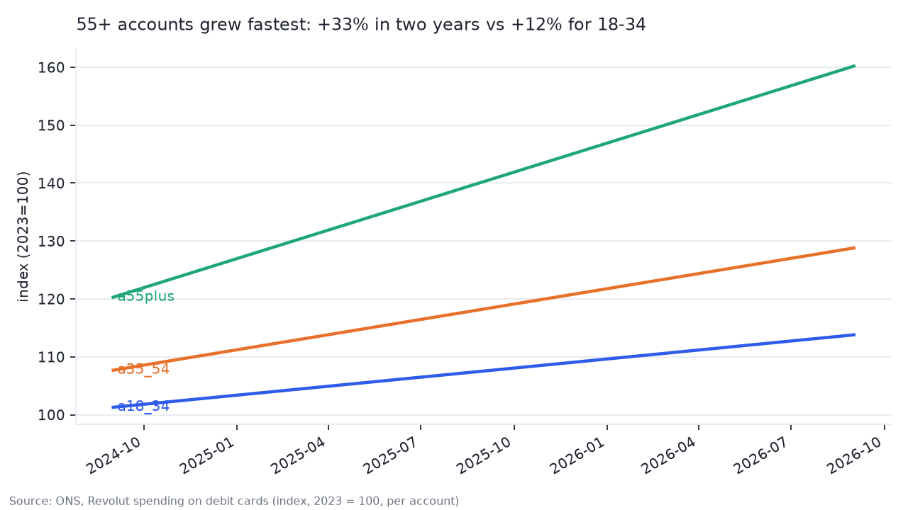
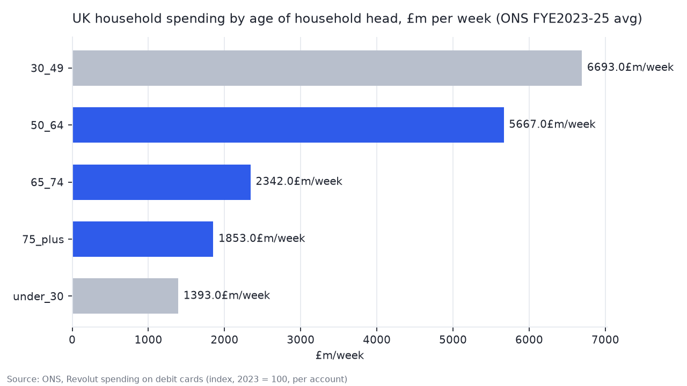
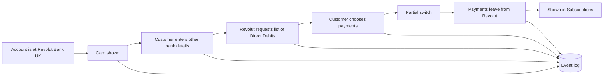

# 01 UK consumer spending -> next-quarter feature bet

Role assumed: Graduate Product Owner (Technical), UK consumer app · Data: ONS "Revolut spending on debit cards", edition 2026-10-29 · Tools: DuckDB, SQL, Python

## 0. The task
A senior PO asked, after the Monday metrics review:
> "Show me, with data, where our UK customers spend more and where they spend less than two years ago. Pick one segment × spend category worth betting a feature on next quarter. Tell me why that one, what we'd build, how much it would move, and how we'd know we were wrong. One page by Friday. No numbers, no meeting."

The deliverable is a feature proposal. The analysis exists to back it.

## How I approached it
| Step | Question | Method | Output |
|---|---|---|---|
| 1. Discover | Where is per-account spend shifting? Who drives it? | Segmentation by category and age. 2-year change and share-of-wallet shift. Segment size from ONS household spending. | Q1–Q4 queries + charts |
| 2. Define | What is the opportunity, in one sentence? Is it real? | Cross-check against cash-to-card shift and new-customer mix. Inflation flagged, not adjusted. Pre-define success metric. | Problem statement |
| 3. Prioritise | Which feature, and why not the others? | 3 options scored on impact × effort × risk. Check what already exists in the app. | Decision + rejected options |
| 4. Spec | What exactly would we build? | User flow, scope-out, system diagram, event logging. | PRD summary |
| 5. Ship | How do we roll it out safely? | Pilot design: segment, %, duration, control group. | Rollout plan |
| 6. Measure | How much would it move? | Segment size × adoption assumption × payments moved per account. Three scenarios. | Impact estimate |
| 7. Learn | How would I know I was wrong? | Stop rules by week. Data this dataset cannot answer. | Limitations + next data request |

Data limits up front: the index is per-account, nominal, UK-only, 2023 = 100. It tells me how fast each category grows, not how big it is. No age × category cross-tab.

## 1. Discover - what the data says

To see where customers spend more than two years ago, I first need to know which spend categories grew between September 2024 and September 2026. So I compare each category's index at those two points and rank them by growth.

### Q1 · Which categories grew, Sep 2024 → Sep 2026?
Query: [`sql/q1_change_2y.sql`](sql/q1_change_2y.sql)

**Recurring spend is outpacing everything else.** Per-account spend rose 18% in two years, but unevenly. The fastest-growing categories are recurring, mostly at-home payments: Entertainment +41%, Utilities +28%, Transport +24%, Services +24%, Health +23%. Discretionary, out-of-home spend grew below total: Restaurants +14%, Travel +13%. Groceries (+16%) is the exception — recurring, yet slow.

Entertainment stands alone: 13pp ahead of second place and 2.3x the total rate.

Q1 only shows how much each category grew versus two years ago. All nine went up, so on its own it cannot answer where customers spend more and where they spend less. But total spend rose 18%: any category that grew more slowly than that is one where customers allocated less of their extra money. I redefine "spending less" as losing share of total, and divide each category's index by the total index.

### Q2 · Which categories gained or lost share of spend?
Query: [`sql/q2_mix.sql`](sql/q2_mix.sql) · rel_idx = category index ÷ total index, Sep 2026 (1.00 = grew at the same pace as total since 2023)

**Only Entertainment is pulling share; dining and travel are losing it.** Entertainment sits at 1.25 — it grew 25% faster than total spend. Services, Utilities, Shopping, Health and Transport cluster at 1.04–1.09, close to total. Restaurants (0.92) and Travel (0.93) are below 1: spend on both still rose, but more slowly than everything else, so their share of the wallet shrank.

Q1 and Q2 answered "where": Entertainment is the fastest-growing category. The task asks for a segment × category, so now I need the segment. The only customer segment this dataset offers is age — three groups, 18-34, 35-54 and 55+. Since Entertainment grew fastest, my assumption is that younger customers, the heaviest entertainment consumers, are driving it. I test that with each age group's two-year change.

### Q3 · Which age group drives the growth?
Query: [`sql/q3_age.sql`](sql/q3_age.sql) · chart data: [`sql/q3_age_monthly.sql`](sql/q3_age_monthly.sql)

**The older the account, the faster it grew.** From Sep 2024 to Sep 2026, per-account spend rose 33% for 55+, 20% for 35-54 and 12% for 18-34, against 18% overall. The three groups moved almost together through 2022-2023; from 2025, 55+ pulled away upward. 35-54 and 55+ show a clear year-end peak every December; 18-34 does not.

This rejects the assumption that younger customers drive the growth. Two things this data cannot tell me: which age group spends the most in absolute terms (each index is relative to that group's own 2023 average), and which group contributes most to total growth (the £ weight of each group is unknown).

Q3 reverses the starting assumption. The segment adding spend fastest is not 18-34 but 55+. Growth alone, however, does not justify a feature bet: a segment can grow quickly from a small base. The next question is therefore size — how much the 55+ segment spends in absolute terms. This dataset is a per-account index and cannot answer that, so I turn to ONS household expenditure by age.

Decision rule, set before looking at the data: I will target the segment with the highest growth, provided it accounts for at least 25% of UK household spending. Below that threshold, I switch to the largest segment that still grows above the overall rate.

### Q4 · How big is the 55+ segment in £?
Query: [`sql/q4_age_size.sql`](sql/q4_age_size.sql) · Data: ONS Family Spending FYE2023-25, Tables A12-A16 (`data/external/`)

**55+ is a large segment, not a niche.** Households headed by someone aged 50-64 spend the most per week (£688). Households headed by someone aged 30-49 are the largest group in total (£6.7bn a week, 37%). Add up every household headed by someone aged 50 or over and they make up 55% of UK weekly spending.

ONS splits age at 50 and 65, not at 55. So I can only give a range for 55+: 23% if I count 65+ only, 55% if I count everyone 50+, and about 44% if I assume 55-64 is two-thirds of the 50-64 group. The lowest figure is close to the 25% bar I set before running the query. The middle figure clears it easily.

The last time Revolut published its UK customer mix was July 2022: 11% of 4.8m UK customers were 55+. The UK base has since grown to 13m, with no newer split. Even against the lowest market figure (23%), 55+ was under-represented at Revolut by about half. That means two opportunities at once: the 55+ customers already on Revolut are growing their spend fastest (Q3), and most 55+ spenders in the UK are not on Revolut yet.

Two caveats on this comparison. First, the two datasets count different things: ONS counts UK households, the Revolut index counts Revolut accounts. So I use ONS only to answer "how big is the market" and the Revolut data only to answer "how fast is it growing" — I never multiply one by the other. Second, both numbers are dated: the ONS figure is a 2023-25 average and the Revolut 11% is from 2022. An up-to-date 55+ share of Revolut's UK base would be needed to confirm the gap; I list it as the first data gap in section 7.

## What the four findings say together
Customers are spending more each year, and the extra money is going to recurring, at-home payments rather than eating out or travel (Q1, Q2). Older customers are driving this most: 55+ accounts grew 33% in two years, against 18% overall (Q3). That segment is large — at least a quarter of UK household spending — and was under-represented at Revolut the last time the mix was published (Q4).

So the segment is 55+. Whether 55+ customers are also the ones adding recurring spend fastest is a hypothesis, not a fact: this dataset has no age × category split. Revolut already has a Subscriptions feature for recurring payments. Whether that feature reaches the 55+ segment is the question for the next section.

## 2. Define

**The opportunity.** 55+ customers are growing their spend fastest (Q3). Across all customers, the growth is in recurring payments, not discretionary ones (Q5). So: recurring payments, for 55+.

Query: [`sql/q5_recurring_vs_discretionary.sql`](sql/q5_recurring_vs_discretionary.sql) · simple average of category indices, not weighted by £

| spend_type | n_sectors | idx_2024 | idx_2026 | change_pct |
|---|---|---|---|---|
| recurring | 6 | 105.0 | 132.5 | +26.0 |
| discretionary | 3 | 101.7 | 118.1 | +16.0 |

**Could the numbers be misleading?**

| Possible reason | Why it is not the reason |
|---|---|
| More customers joined. | The index is per account. Customer growth is already removed. |
| People switched from cash to card. | Cash was mostly used for discretionary spend. A switch would lift discretionary first. It did not. |
| 55+ grew fastest, but maybe not in recurring. | Cannot be checked here — no age × category data. This is the first hypothesis to test internally (section 7). |

Inflation is not adjusted. 

**Direction (draft).** Revolut already has recurring-payment tools (Subscriptions; AIR since April 2026). Hypothesis: 55+ customers do not find them. Over-65s are the least likely group to use digital finance features on their own (UK Finance 2025: 29% use a mobile wallet vs 89% of 25-34s). The direction is to bring the existing tools to them. 

**Success metric, fixed now.**

| Type | Metric | Target |
|---|---|---|
| North Star Metric | Recurring card payments per 55+ account, monthly | +5% vs control cohort at week 8 |
| Guardrails | Notification opt-outs · uninstalls · support tickets | Stop at +2pp · +0.5pp · +20% |
| Design | A/B test, all ages exposed, results split by age band | 55+ effect must be larger than the all-ages effect |

Feature-level metrics follow in section 6.

Target: +5% vs control at week 8. Reasoning: 55+ spend per account already grows about 2.5% in any eight-week period with no new feature (Q3: +33% over two years). A feature worth building should add at least that much again. Sample size is calculated in section 6.

## 3. Prioritise
Before choosing a feature, I checked what Revolut already has. Subscriptions shows a customer's recurring payments and sends an alert before each one. AIR, released in April 2026, can find and cancel a subscription. Revolut also became a licensed UK bank in March 2026, and it has been moving existing customers to bank accounts since August.

After this check, I think my assumption in section 2 was wrong. I assumed 55+ customers could not find these tools. But the tools only work for payments made from a Revolut account. If a customer pays their bills from another bank, the tools have nothing to show.

I think this is the case for most 55+ customers. Revolut was not a bank until this year, so deposits were not protected. Finder reports an average monthly deposit of about £480 in 2023, which is much less than a salary. In 2022 Revolut said its 55-74 customers mostly spent at post offices, cafes and supermarkets. So 55+ customers probably used Revolut for daily spending and kept their bills at their main bank. I cannot prove this with the data I have. Utilties grew 28% in Q1, so some customers already pay bills with Revolut. I list the missing data in section 7.

I considered three options. The first was a new alert for recurring payments, but Subscriptions already does this. The second was a view of recurring payments for the whole household, but joint accounts already exist and it needs a lot of consent and legal work. The third was to help customers move some of their bills to Revolut when their account becomes a bank account. I chose the third and call it Bills Switch.

One thing I have not tested: I assume older customers kept their bills at another bank because Revolut had no deposit protection. If the real reason is different, Bills Switch will not work. The pilot in section 5 tests this.

Because the direction changed, the metric in section 2now includes Direct Debits as well as card payments.

## 4. Spec

Bills Switch is shown to customers whose account has moved to Revolut Bank UK. It appears once, on the home screen. Before the move the account has no deposit protection, so the message would not be true.

Some customers have already been moved to the bank, and others will be moved later. For customers who are moved later, the card appears right after the move. For customers who were moved before this feature exists, the card appears the first time they open the app after launch. I do not know how many customers are in each group. I list this in section 7.

The customer goes through these steps:

1. A card appears on the home screen: "Your money is now protected up to £120,000. Do you want to move a bill here?" The customer taps it.
2. The customer enters the details of their other bank account.
3. Revolut asks the other bank for the list of Direct Debits. This is not instant. When the list arrives, the customer gets a notification.
4. The customer chooses which ones to move. They can choose only one.
5. The app shows a confirmation: the other account stays open, and only the chosen payments move. It also shows the date the move will finish. The customer approves.
6. The chosen payments start to leave from Revolut. They appear in Subscriptions, and the customer gets an alert before each payment.

I let the customer move only one bill because it is a small step. Most 55+ customers have used their main bank for a long time, and I do not think they will move everything at once. If one bill works well, they may move more later.

This uses the partial switch of the UK Current Account Switch Service. It lets a customer choose which payments to move and keep the old account open. It has three limits. It is slow: banks quote from a few working days to about four weeks. It is not covered by the Current Account Switch Guarantee. And it depends on the billing company updating the account details, so a payment can fail. Because of this, I add one guardrail to section 2: the number of failed Direct Debits in the 60 days after a switch. I expect step 3 to lose the most customers, because they have to wait and come back.

The first version does not include the following.

- Showing the card only to 55+ customers. Customers of all ages see it, so that I can compare how each age group responds. This was the test design in section 2.
- Asking the customer to move their salary or to close their old account. These are much bigger requests than moving one bill, and I want the first step to be small.
- A new alert for recurring payments. Subscriptions already sends one.
- Asking the customer to move a second bill after the first. I want to see if the first move works before asking for more.
- Paying a bill for the customer if a moved Direct Debit fails. This would protect the customer, but it has a cost and needs legal review. I first measure how often payments fail.

To measure the feature later, the app records an event at each step.

| Event | When it is recorded |
|---|---|
| `switch_card_shown` | The card appears on the home screen |
| `switch_started` | The customer taps the card |
| `bank_details_entered` | The customer enters their other bank account |
| `payment_list_received` | The list of Direct Debits arrives from the other bank |
| `payments_chosen` | The customer chooses which payments to move and approves |
| `switch_completed` | The chosen payments start to leave from Revolut |
| `direct_debit_failed` | A moved payment fails |
| `direct_debit_active_30d` | A moved payment is still on Revolut after 30 days |

Each event also records the customer's age band and whether they are in the group that sees the card or the group that does not.

## 5. Ship

I would not turn this on for all customers at once. If something goes wrong with Direct Debits, a customer can miss a bill. So I use two things together: an A/B test and a staged rollout.

**A/B test.** Customers whose account is at Revolut Bank UK are split into two groups at random. One group sees the card (treatment) and the other does not (control), so I can compare the two. Customers of all ages are included, and I read the results by age band.

**Staged rollout.** The feature is turned on in steps: staff accounts first, then 1% of customers, then 10%, then 50%. At each step, the customers in that step are split into the two groups of the A/B test. I move to the next step only if the guardrails are not crossed. If any guardrail is crossed, the feature is turned off. The guardrails are the ones in section 2, plus the number of failed Direct Debits that I added in section 4. The percentages are common values that I chose. The exact percentages would follow Revolut's own rollout rules.

In section 2 I planned to read the main result at week 8. I change this to week 12. A partial switch can take up to about four weeks, so at week 8 some customers would not have made a single payment from Revolut yet.

| Item | Plan |
|---|---|
| Who | Customers whose account is at Revolut Bank UK |
| A/B test | Random, half see the card and half do not |
| Staged rollout | Staff, 1%, 10%, 50% |
| First check | Week 4: how many customers start and how many payments fail |
| Main result | Week 12: recurring payments per 55+ account, compared with the control group |

## 6. Measure

### How big could it be

I cannot know the result before the test. I can only make assumptions and multiply them.

- 55+ accounts in the UK: about 1.43 million. This is 13 million UK customers × 11%, the share of 55+ customers that Revolut published in 2022. The share may be different now.
- Bills moved per customer: 1, because the first version asks for one bill (section 4).
- Share of 55+ customers who move a bill: 1%, 2% or 4%.

For the last number I looked for real figures. In the UK about 1.15 million current accounts were switched in the 12 months to March 2026, which is about 2% of account holders a year. In a KPMG survey, 4% of people aged 65 and over said they had switched a bank account in the past year, the lowest of any age group. So I use 2% as the base case, 4% as the high case and 1% as the low case.

These figures are not the same thing as my feature. They count people who switched a bank in a year. My feature asks a customer once to move one bill. I use them only as a starting point, and I will replace them with the result at week 4.

| Case | Share who move a bill | 55+ accounts | Extra recurring payments a month |
|---|---|---|---|
| Low | 1% | 14,000 | 14,000 |
| Base | 2% | 29,000 | 29,000 |
| High | 4% | 57,000 | 57,000 |

I do not estimate revenue. I found no public figure for the value of one Direct Debit to a bank.

### What I measure after launch

| Type | What I look at | Why |
|---|---|---|
| North Star Metric | Recurring payments per 55+ account each month, card and Direct Debit together. Treatment group compared with control group at week 12. | This is the goal of the feature. |
| Funnel | Of the customers who see the card, how many tap it, enter their bank details, choose a payment, and finish the switch. Read by age band. | It shows at which step customers stop, so I know what to fix. |
| Retention cohort | Of the payments that were moved, how many are still on Revolut after 30, 60 and 90 days. Customers are grouped by the week they switched. | A payment that moves back does not help. |
| Guardrails | Notification opt-outs, uninstalls, support tickets, and failed Direct Debits. Treatment group compared with control group every day. | If these get worse, the feature is turned off. |

The funnel uses the events from section 4. I expect the largest drop between entering the bank details and choosing a payment, because the customer has to wait for the list and come back.

## Sources
- ONS, Revolut spending on debit cards, edition 29 Oct 2026
- ONS, Family spending in the UK: April 2024 to March 2025, Workbook 2 Tables A12–A16 (released 11 Jun 2026)
- Revolut, "Revolut tops 20 million retail customers on seventh anniversary", 15 Jul 2022
- Revolut, Annual Report 2025 (UK customers 13m)
- UK Finance, UK Payment Markets Report 2025
- Revolut, "Revolut Launches UK Bank", 11 Mar 2026
- Finder, Revolut statistics (average monthly deposit, 2023)
- Fintech press coverage of Revolut's 55-74 user data, May 2022
- Pay.UK, Current Account Switch Service dashboard, Q1 2026
- KPMG survey on bank account switching, reported January 2025
