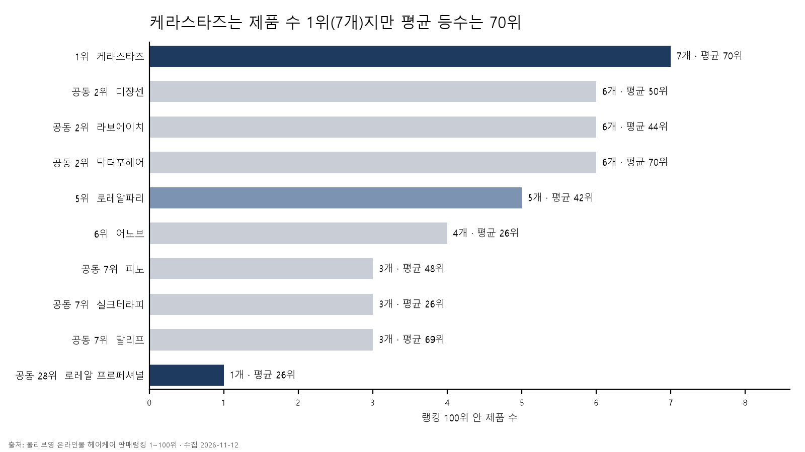

# 03_kr-haircare-trends 작업 지침

## 목적
전체 흐름은 3단계다. 이 폴더는 1~2단계를 다루고, README는 3단계까지 한 줄로 이어지게 쓴다.

| 단계 | 내용 | 산출물 |
|---|---|---|
| 1. 데이터 분석 | 판매 랭킹, 검색 수요, 업계 동향 세 종류의 데이터를 분석한다 | 쿼리, 결과 CSV, 차트 |
| 2. 인사이트 도출 | 세 데이터를 교차해 무엇을 뜻하는지, 어떤 과정으로 그 결론에 닿았는지 정리한다 | README `인사이트` 절, `creative/concept.md` |
| 3. 영상 제작 | 인사이트를 근거로 로레알 헤어제품을 알리는 영상을 힉스필드로 만든다 | 영상, 프롬프트 기록 |

- 핵심은 "데이터 → 인사이트 → 콘텐츠"의 연결이다. 영상의 제품·메시지·색감 선택마다 근거가 되는 분석 결과를 댈 수 있어야 한다.
- 데이터 하나로 결론 내지 않는다. 팔리는 것(랭킹), 찾는 것(검색), 업계가 미는 것(동향)이 겹치는 지점을 찾는다.
- 인사이트는 결론만 적지 않는다. 어떤 결과를 보고 어떤 추론을 거쳤는지 과정을 남긴다.
- 산출물은 깃허브 README에 쌓는 포트폴리오다. 질문 1개 = 차트 1장 = 커밋 1개.

## 홍보 제품과 타깃
- 영상으로 홍보할 제품은 로레알 그룹 프로페셔널 사업부 브랜드(로레알 프로페셔널, 케라스타즈) 제품 중에서 고른다. 이것만 고정 조건이다. 브랜드 간 우선순위는 두지 않는다.
- 제품 전략은 분석이 끝난 뒤 셋 중 하나를 고른다.
  - A. 숨은 제품 알리기: 수요가 큰 주제인데 검색·랭킹 100위에 없는 제품
  - B. 잘 나가는 제품 밀기: 이미 랭킹·검색에 오른 제품
  - C. 뜰 제품 선점: 검색 추이가 상승하는 주제에 맞는 제품이나 신제품
- 어느 전략을 왜 골랐는지 README 인사이트 절에 근거 질문 번호와 함께 남긴다.
- 케라스타즈는 비교군이 아니다. 분석에서는 "2030 여성이 프로페셔널 사업부 브랜드를 이미 찾는다"는 근거로 쓴다.
- 로레알파리는 컨슈머 사업부 브랜드라서 홍보 후보가 아니다. 랭킹·검색에 나오는 경쟁 브랜드 중 하나로만 다룬다.
- 타깃은 2030 여성이다. 헤어 제품을 가장 많이 사는 층이라서가 아니라, 판매 랭킹을 분석하는 채널인 올리브영에서 비중이 큰 층이라서 골랐다. 근거는 다음과 같다.
  - 올리브영 결제추정금액의 56.5%가 30대 이하 (와이즈앱·리테일, 2026년 4~6월). 성별 구분 없음
  - 올리브영 앱 사용자의 84.6%가 여성 (와이즈앱·리테일·굿즈, 2024년 8월). 연령과 묶은 값 아님
  - 2030 여성의 네이버 헤어케어 인기검색어 100위 안에 케라스타즈 관련 검색어 6개, 최고 10위 (데이터 B). 전체는 2개, 최고 29위
- 참고(README에는 넣지 않기로 함, 사용자 결정): 네이버쇼핑 헤어케어 분야 클릭은 여성 74%, 연령은 40대·50대가 1·2위다 (쇼핑인사이트, 2026.10.11~11.11).
- "2030 여성이 프로페셔널 브랜드를 더 찾는다"고 쓰지 않는다. 다른 세그먼트와 비교하지 않았고, 인기검색어 순위는 양이 아니다. "100위 안에 N개 있다"까지만 쓴다.
- "주 고객", "큰손", "대부분"이라는 표현은 근거가 없어서 쓰지 않는다.

## 역할 분담 (반드시 지킬 것)
| 작업 | 담당 |
|---|---|
| SQL 쿼리 작성 | 사용자 |
| 결과 해석, 발견 문장 | 사용자 |
| 네이버 데이터 조회·다운로드 | 사용자 |
| CSV 정리·DB 적재, 쿼리 실행, 결과 저장 | Claude |
| 차트 PNG 생성 | Claude |
| README 단락 반영 | Claude |
| 커밋 | Claude (메시지를 보여주고 승인 후 실행) |

- 쿼리를 대신 작성하지 않는다. 사용자가 쓴 쿼리에 오류가 있으면 위치와 이유만 알려준다.
- 사용자가 "쿼리 써줘"라고 명시할 때만 작성한다.
- 사용자는 SQL 입문 단계다. 새 문법이 나오면 표 1개와 2~3줄로 설명한다.
- 발견 문장은 사용자가 말한 내용을 다듬어 쓴다. 데이터에 없는 해석을 덧붙이지 않는다.

## 폴더 구조
```
03_kr-haircare-trends/
├─ CLAUDE.md
├─ README.md            # 포트폴리오 본문
├─ data/
│  ├─ oliveyoung_hair_rank_20261112.csv   # 데이터 A
│  ├─ naver_shopping_keywords.csv         # 데이터 B
│  ├─ naver_search_trend_*.csv            # 데이터 C
│  ├─ industry_signals.csv                # 데이터 D
│  └─ haircare.db                         # SQLite (커밋 제외)
├─ sql/                 # NN_이름.sql — 사용자가 작성
├─ analysis/            # NN_이름.csv, NN_이름.png — Claude가 생성
├─ scripts/             # 적재·실행·차트 스크립트
└─ creative/            # 영상 콘셉트, 프롬프트
```

## 데이터 구성
| | 데이터 | 답하는 질문 | 테이블 | 상태 |
|---|---|---|---|---|
| A | 올리브영 헤어케어 판매랭킹 100위 | 지금 무엇이 팔리는가 | `oy_rank` | 적재 완료 |
| B | 네이버 쇼핑인사이트 헤어케어 인기 검색어 | 소비자가 무엇을 찾는가 | `nv_keyword` | 수집 완료, 적재 전 |
| C | 네이버 데이터랩 검색어 트렌드 (주제별 추이) | 어떤 관심이 오르고 내리는가 | `nv_trend` | 미수집 |
| D | 업계 동향 (리포트·기사·공시) | 업계가 어디로 가는가 | `industry_signal` | 초안 있음 |

### A. `oy_rank` (100행)
- 출처: 올리브영 온라인몰 헤어케어 판매랭킹 1~100위, 2026-11-12 오전 수집
- 한 행 = 랭킹에 오른 제품 1개

| 컬럼 | 타입 | 설명 |
|---|---|---|
| rank | INTEGER | 판매 순위 1~100 |
| goods_no | TEXT | 상품 번호 |
| brand | TEXT | 브랜드 |
| product_name | TEXT | 제품명 (프로모션 문구 포함) |
| cat_mid | TEXT | 중분류 (헤어 세정류, 헤어 트리트먼트 등) |
| cat_small | TEXT | 소분류 (샴푸, 헤어오일 등) |
| list_price | INTEGER | 정가. 정가 표기가 없으면 판매가와 같음 |
| sale_price | INTEGER | 판매가 |
| discount_pct | REAL | 할인율 % |
| is_set | INTEGER | 제품명에 기획·더블·듀오·1+1·세트·2입·증정·키트가 있으면 1 (67개) |
| has_sale / has_coupon / has_gift | INTEGER | 세일·쿠폰·증정 표시 여부 |
| collected_at | TEXT | 수집일 |

- `brand = '로레알'`은 로레알파리(대중 라인)다. 살롱 라인은 `로레알 프로페셔널`, `케라스타즈`다.
- 한 시점의 순위다. 판매량, 리뷰 수, 시간 추이는 없다. "매출", "판매량 N개"로 쓰지 않는다.
- `is_set`은 제품명 키워드 기반 추정이다. README에 정의를 밝힌다.

### B. `nv_keyword` (200행) — 적재 대상 `data/naver_shopping_keywords.csv`
- 출처: 네이버 데이터랩 쇼핑인사이트 > 분야 통계 > `화장품/미용 > 헤어케어` 인기검색어 1~100위, 2026-11-12 수집
- 조건: 기간 최근 1년. 세그먼트 2개 — `전체`(기기·성별·연령 전체), `2030여성`(여성, 20대+30대)
- 컬럼: `segment, period, rank, keyword, topic, is_brand, needs_check, collected_at`
- `topic` 10종: 탈모, 두피케어, 손상·복구, 윤기·오일, 염색·컬러, 스타일링, 향, 세정 일반, 브랜드 일반, 기타
- 분류 규칙: 검색어에 제품 유형·고민이 드러나면 그 주제. 브랜드명만 있으면 `브랜드 일반`. 머리 빠짐·볼륨은 `탈모`, 비듬·지성·각질·진정은 `두피케어`
- `needs_check`는 모두 0이다. 추정 분류했던 10개를 검색과 사용자 확인으로 확정했다 (2026-11-12).
- 분류는 분석자가 정한 규칙 기반이다. README에 규칙을 밝힌다.
- 순위만 있고 클릭 수는 없다. "N위 안에 M개"로 쓴다.
- 2030 여성은 "주 고객층"이 아니라 전체와 비교하는 세그먼트다. 주 고객이라고 쓰지 않는다.

### C. `nv_trend` — 사용자가 수집
- 경로: 네이버 데이터랩 > 검색어트렌드. 주제어 5개까지 한 번에 비교, 엑셀 다운로드
- 조건: 기간 최근 2년, 월간
- 주제어 묶음은 B의 `topic` 분류를 보고 사용자가 정한다. 한 묶음에 대표 검색어 3~5개
- 컬럼: `month, topic, ratio`
- 값은 조회 구간 최댓값을 100으로 둔 상댓값이다. "검색량 N건"으로 쓰지 않는다. 같은 조회에서 받은 주제끼리만 크기를 비교한다.

### D. `industry_signal` — 정성 자료
- 리포트·기사·공시에서 뽑은 트렌드 단서를 한 행씩 기록한다.
- 컬럼: `signal, topic, source, published, url, note`
- `topic`은 B와 같은 분류를 써서 조인할 수 있게 한다.
- 초안(사용자가 출처를 다시 확인한 뒤 확정):

| signal | topic | 출처 |
|---|---|---|
| 기능성 두피 앰플·세럼 매출 +52% (일반 샴푸 +12%) | 두피·탈모 | CJ올리브영 발표, 마이데일리 보도 |
| 2026 트렌드 '하이퍼 감각 헤어케어'(멘톨 × 두피) | 두피·탈모 | 화해 2026 뷰티 트렌드 리포트 |
| 복구보다 보존으로 이동 | 손상·복구 | BeautyMatter 2026 전망 |
| 2026 컬러 트렌드 '브론드 블렌즈' | 염색·컬러 | 로레알 프로페셔널 발표 |
| 2026-27 겨울 리치 브루넷·크리미 블론드·광택 마감 | 윤기·광택 | HOLA 2026-11 |
| 프로페셔널 사업부 9개월 누적 조정 성장률 +12.3%, 동력은 헤어케어 프리미엄화 | 기타 | 로레알 2026년 3분기 매출 공시 |

## 분석 질문
| # | 데이터 | 질문 | 파일명 | 차트 |
|---|---|---|---|---|
| 1 | A | 브랜드별 제품 수와 평균 순위 | 01_brand_share | 가로 막대, 상위 10개 브랜드 |
| 2 | A | 소분류별 제품 수 | 02_category | 가로 막대 |
| 3 | A | 세트와 단품의 순위 차이 | 03_set_vs_single | 순위 구간별 세트 비율 |
| 4 | A | 가격대별 제품 수 | 04_price_band | 히스토그램 |
| 5 | A+B | 프로페셔널 사업부 브랜드 제품의 위치(랭킹 순위 × 가격, 검색 등장 여부). 로레알파리는 참고로만 표시 | 05_loreal_position | 가격 × 순위 산점도 |
| 6 | B | 인기 검색어의 주제별 분포 | 06_keyword_topic | 가로 막대 |
| 7 | B | 전체와 2030 여성의 검색어 차이 | 07_keyword_segment | 순위 비교 |
| 8 | C | 주제별 검색 관심 2년 추이 | 08_topic_trend | 선 그래프 |
| 9 | A+B | 검색 주제 비중과 랭킹 제품 비중의 차이 | 09_demand_vs_supply | 나란한 막대 |
| 10 | A+B+D | 세 데이터가 모두 가리키는 주제 | 10_signal_overlap | 주제 × 데이터 표 |

- 진행 상태: 1번과 1-1번(`01b_pro_products`, 프로페셔널 사업부 브랜드 제품별 순위)은 README 반영과 커밋까지 끝났다. 다음은 2번이다.
- 9번이 핵심이다. 찾는 사람은 많은데 랭킹에 제품이 적은 주제가 기회 영역이다.
- 질문은 사용자가 바꾸거나 추가할 수 있다. 1~5번을 먼저 끝내고 B·C 수집으로 넘어간다.

## 작업 흐름
사용자가 `sql/NN_이름.sql`을 저장하고 "NN 반영해줘"라고 하면 다음을 순서대로 한다.
1. 쿼리를 `data/haircare.db`에 실행한다. 오류면 멈추고 원인만 알린다.
2. 결과를 `analysis/NN_이름.csv`로 저장한다 (utf-8-sig).
3. 결과 표를 보여주고 사용자에게 발견을 묻는다.
4. 차트를 `analysis/NN_이름.png`로 만든다.
5. README에 단락을 추가한다.
6. 커밋 메시지를 제안하고 승인을 받아 커밋한다. push는 요청할 때만 한다.

사용자가 네이버 파일을 `data/`에 넣고 "적재해줘"라고 하면: 컬럼을 위 정의에 맞춰 정리 → 테이블 생성 → 행 수와 샘플 5행을 보여준다.

## 차트 형식 (전 차트 공통)
- matplotlib, 1600×900px, dpi 200, 흰 배경
- 한글 글꼴 `Malgun Gothic`, `axes.unicode_minus = False`
- 기본 막대 `#C9CED6`, 강조 `#1F3A5F`. 강조 대상은 로레알 프로페셔널·케라스타즈, 로레알파리는 `#7D93B2`
- 제목은 발견을 한 문장으로 쓴다. 축 이름만 적은 제목 금지
- 막대 끝에 값 표기, 위·오른쪽 테두리 제거, 격자선 없음
- 왼쪽 아래에 출처와 수집일 표기

## README 형식
```markdown
# 국내 헤어케어 트렌드 분석: 판매 랭킹 × 검색 수요 × 업계 동향
- 데이터: 올리브영 헤어케어 판매랭킹 100위, 네이버 쇼핑인사이트·검색어트렌드, 업계 리포트
- 도구: SQLite, DB Browser for SQLite, matplotlib
- 한계: 랭킹은 한 시점의 순위, 네이버 수치는 상댓값

## 1. 어떤 브랜드가 랭킹을 차지하는가
**쿼리** [`sql/01_brand_share.sql`](sql/01_brand_share.sql)

**발견**
- 한 문장에 한 항목
```
- 발견은 항목당 한 문장, 수치 포함, 형용사·다짐 금지.
- 마지막에 `## 종합`을 두고 한 문장으로만 쓴다.

## 2단계: 인사이트 도출
질문이 끝나면 README에 `## 인사이트` 절을 추가한다. 사용자가 말한 내용을 아래 틀로 정리한다.

| 항목 | 내용 |
|---|---|
| 관찰 | 쿼리 결과에서 확인한 사실 (수치와 질문 번호, 데이터 A~D 표기) |
| 추론 | 그 사실들을 묶으면 무엇을 뜻하는가 |
| 인사이트 | 한 문장 |
| 영상 적용 | 인사이트가 제품·메시지·타깃·색감 선택에 어떻게 이어지는가 |

- 관찰에 없는 내용을 추론에 넣지 않는다.
- 데이터 2종 이상이 뒷받침하면 "인사이트", 1종뿐이면 "가설"로 표기한다.

## 3단계: 힉스필드 영상 (제작은 CLI 밖에서 진행)
- `creative/concept.md`에 다음을 정리한다: 선정 제품과 이유, 핵심 메시지 1문장, 타깃, 색감·톤, 장면 구성, 각 선택의 근거가 된 질문 번호.
- 영상 제작은 힉스필드가 연결된 다른 세션에서 한다. 완성 후 프롬프트와 결과 링크를 `creative/`에 기록하고 README `## 영상` 절에 넣는다.
- 개인 포트폴리오용 콘셉트 작업이다. README에 "로레알 공식 제작물이 아님" 문구는 넣지 않는다 (사용자 결정).

## 커밋 규칙
- 형식: `data:`, `analysis:`, `docs:`, `chore:` + 한국어 요약
- 예: `analysis: 브랜드별 랭킹 점유 (Q1)`
- `*.db`는 `.gitignore`에 추가한다.
- 이 저장소에는 다른 프로젝트 폴더(`01_`, `02_`, `docs`)가 있다. 이 폴더 밖 파일은 수정하지 않는다.
