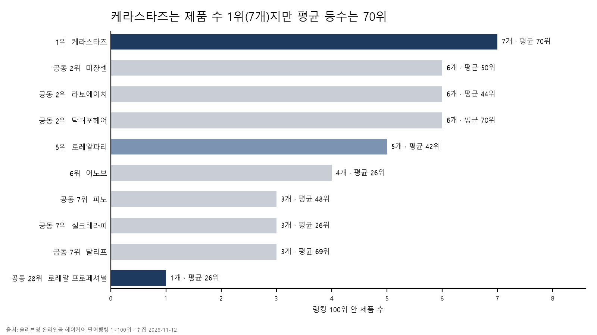
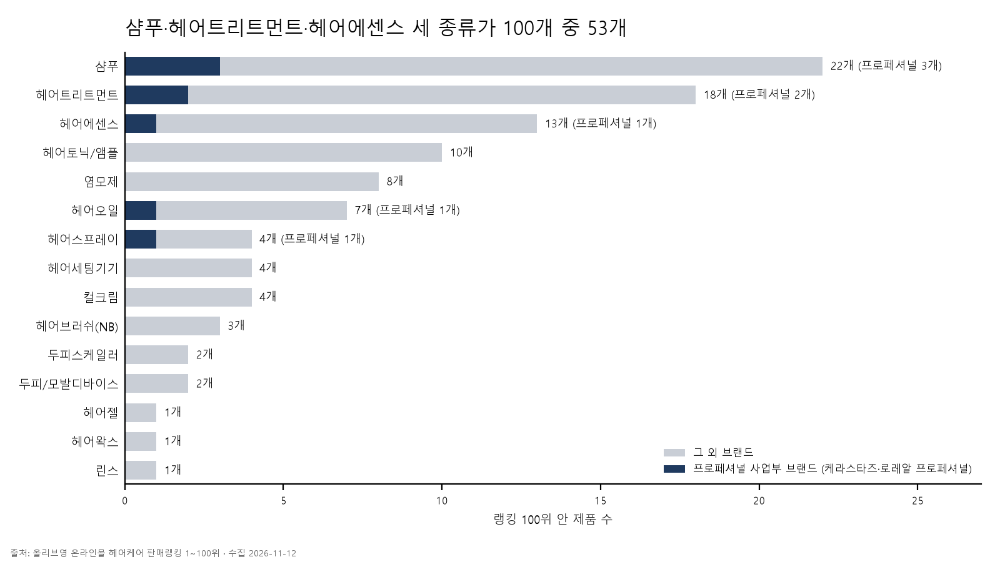

# 국내 헤어케어 트렌드 분석: 판매 랭킹 × 검색 수요 × 업계 동향
## 개요
- **목적**: 2030 여성을 타깃으로 로레알 그룹 프로페셔널 사업부의 두 브랜드(로레알 프로페셔널, 케라스타즈) 헤어 제품의 인지도를 높이는 홍보 영상을 기획함. 본 분석은 그 영상에서 어떤 제품을 어떤 메시지로 알릴지에 대한 인사이트와 근거를 시장 데이터 분석에서 얻는 것을 목표로 함.
- **배경**: 2026년 4~6월 기준 올리브영 결제추정금액의 56.5%가 30대 이하이고(와이즈앱·리테일, [메트로신문 보도](https://www.metroseoul.co.kr/article/20260729500377)), 앱 사용자의 84.6%가 여성임(와이즈앱·리테일·굿즈, 2024년 8월, [파이낸스투데이 보도](https://www.fntoday.co.kr/news/articleView.html?idxno=335063)).
- **타깃**: 올리브영 고객에서 30대 이하와 여성의 비중이 큰 점을 근거로 2030 여성으로 정함.

- **데이터**: 세 종류를 씀. 현재 판매 동향은 올리브영 헤어케어 판매랭킹 100위, 소비자의 선호와 관심도는 네이버 쇼핑인사이트 인기검색어(전체·2030 여성 각 100위)와 검색어트렌드, 업계의 방향성은 리포트·기사·공시 12건을 기준으로 파악함.
- **방법**: 데이터를 SQLite에 적재해 질문 단위로 SQL 쿼리를 작성하고, 세 데이터에서 인사이트를 도출함. 도구는 SQLite, DB Browser for SQLite, matplotlib임.
- **산출**: 질문별 결과, 얻은 인사이트, 그리고 인사이트를 근거로 한 홍보 콘셉트(제품·메시지·색감)임.

**한계**
- 올리브영 랭킹은 데이터를 조회한 시점(2026-11-12)의 순위임. 올리브영이 판매량과 매출을 공개하지 않아서 얼마나 팔렸는지는 알 수 없고, 순위가 시간에 따라 어떻게 바뀌는지도 볼 수 없다는 한계가 존재함.
- 네이버 검색 데이터는 검색 건수가 아니라 순위와 상대값임. 그래서 "몇 번 검색됐다"가 아니라 "어느 쪽이 다른 쪽보다 더 높다"로만 말할 수 있음.

## 1. 어떤 브랜드가 상위 100순위에 있는가
**쿼리** [`sql/01_brand_share.sql`](sql/01_brand_share.sql)

**결과**
- 제품 3개 이상 차지한 브랜드 상위 9곳을 제품 수 순위대로 나타냄.
- 로레알 프로페셔널 사업부의 브랜드(케라스타즈, 로레알 프로페셔널)를 넣음. 로레알 프로페셔널은 제품 1개라 순위 밖이지만 함께 표시함.
- 평균 등수는 반올림한 값임. 전체 48개 브랜드는 [`analysis/01_brand_share.csv`](analysis/01_brand_share.csv)에 있음.

| 제품 수 순위 | 브랜드 | 제품 수 | 평균 등수 |
|---|---|---|---|
| 1위 | 케라스타즈 | 7 | 70 |
| 공동 2위 | 미쟝센 | 6 | 50 |
| 공동 2위 | 라보에이치 | 6 | 44 |
| 공동 2위 | 닥터포헤어 | 6 | 70 |
| 5위 | 로레알파리 | 5 | 42 |
| 6위 | 어노브 | 4 | 26 |
| 공동 7위 | 피노 | 3 | 48 |
| 공동 7위 | 실크테라피 | 3 | 26 |
| 공동 7위 | 달리프 | 3 | 69 |
| 공동 28위 | 로레알 프로페셔널 | 1 | 26 |

**발견**
- 100위 안에 브랜드가 48개 있고, 제품 3개 이상인 브랜드 9곳이 100개 중 43개를 차지함.
- 케라스타즈는 제품 수 1위(7개)인데 평균 등수는 70위임.
- 어노브(4개)와 실크테라피(3개)는 평균 등수가 26위임.
- 프로페셔널 사업부 브랜드는 합해서 8개임(케라스타즈 7개, 로레알 프로페셔널 1개).

### 1-1. 프로페셔널 사업부 브랜드 제품 중 어떤 제품이 몇 순위로 올라와 있는가
**왜 제품 단위까지 살펴야 할까**
- 케라스타즈는 제품 수 1위(7개)인데 평균 등수는 70위임. 7개가 어느 순위에 흩어져 있는지 알 수 없어서 제품별 순위를 따로 뽑음.
- 홍보할 제품은 로레알 그룹 프로페셔널 사업부 브랜드(로레알 프로페셔널, 케라스타즈)에서 고름. 어떤 제품이 이미 랭킹에 올라 있는지 알아야 이후 제품 선택의 근거를 댈 수 있음.

**쿼리** [`sql/01b_pro_products.sql`](sql/01b_pro_products.sql)

**결과**

| 브랜드 | 순위 | 제품명 | 소분류 | 판매가 | 세트 여부 |
|---|---|---|---|---|---|
| 로레알 프로페셔널 | 26 | [올영단독] 로레알 프로페셔널 에르네뜨 퓨어 헤어 스프레이 무향 300ml/500ml (기획/단품) | 헤어스프레이 | 16,060 | 세트 |
| 케라스타즈 | 27 | [열보호] 케라스타즈 시몽 테르미크 노워시 트리트먼트 150ml (기획/단품) | 헤어에센스 | 51,590 | 세트 |
| 케라스타즈 | 41 | 케라스타즈 샴푸 500ml 단품/기획 10종 모음 | 샴푸 | 51,590 | 세트 |
| 케라스타즈 | 65 | [NEW/리바이탈라이징] 케라스타즈 방 크로놀로지스트 샴푸 500ml | 샴푸 | 80,850 | 단품 |
| 케라스타즈 | 74 | [윤기케어] 케라스타즈 엘릭서 얼팀 헤어 오일 75ml 단품/리필 | 헤어오일 | 71,610 | 단품 |
| 케라스타즈 | 90 | 케라스타즈 헤어 마스크 200ml 단품/기획 9종 모음 | 헤어트리트먼트 | 60,830 | 세트 |
| 케라스타즈 | 91 | [플로럴부케향] 케라스타즈 글로스 압솔뤼 크림 헤어 마스크 200ml (기획/단품) | 헤어트리트먼트 | 60,830 | 세트 |
| 케라스타즈 | 99 | [지성 두피 케어] 케라스타즈 디발렁 샴푸 500ml | 샴푸 | 57,750 | 단품 |

- 세트 여부는 제품명에 기획·더블·듀오·1+1·세트·2입·증정·키트가 있으면 세트로 본 추정값임.

**발견**
- 케라스타즈 7개의 순위는 27, 41, 65, 74, 90, 91, 99위로, 50위 안은 2개이고 나머지 5개는 65위 이하임.
- 케라스타즈에서 순위가 가장 높은 제품은 시몽 테르미크 노워시 트리트먼트(27위, 헤어에센스)임.
- 케라스타즈 7개는 샴푸 3개, 헤어트리트먼트 2개, 헤어에센스 1개, 헤어오일 1개임.
- 로레알 프로페셔널은 헤어스프레이 1개(26위, 16,060원)만 올라 있음.

## 2. 어떤 종류의 제품이 상위 100순위에 있는가
**쿼리** [`sql/02_category.sql`](sql/02_category.sql)

**결과**
- 제품 종류(올리브영 소분류) 15개를 제품 수 순서대로 나타냄.
- 표의 셋째 칸은 그 종류의 제품 중 케라스타즈·로레알 프로페셔널 제품이 몇 개인지 나타냄. 예를 들어 샴푸 22개 중 3개가 케라스타즈 제품임.
- 셋째 칸의 값은 2번 쿼리가 아니라 1-1 결과(두 브랜드 제품 8개 목록)에서 가져옴.

| 제품 종류 | 제품 수 | 그중 프로페셔널 사업부 브랜드 |
|---|---|---|
| 샴푸 | 22 | 3 |
| 헤어트리트먼트 | 18 | 2 |
| 헤어에센스 | 13 | 1 |
| 헤어토닉/앰플 | 10 | 0 |
| 염모제 | 8 | 0 |
| 헤어오일 | 7 | 1 |
| 헤어스프레이 | 4 | 1 |
| 헤어세팅기기 | 4 | 0 |
| 컬크림 | 4 | 0 |
| 헤어브러쉬(NB) | 3 | 0 |
| 두피스케일러 | 2 | 0 |
| 두피/모발디바이스 | 2 | 0 |
| 헤어젤 | 1 | 0 |
| 헤어왁스 | 1 | 0 |
| 린스 | 1 | 0 |

**발견**
- 제품 종류 15개 중 샴푸 22개, 헤어트리트먼트 18개, 헤어에센스 13개로, 상위 3개 종류가 100개 중 53개를 차지함.
- 헤어토닉/앰플은 10개로 4위이고, 염모제는 8개로 5위임.
- 프로페셔널 사업부 브랜드 8개는 샴푸 3개, 헤어트리트먼트 2개, 헤어에센스 1개, 헤어오일 1개, 헤어스프레이 1개에 있음.
- 헤어토닉/앰플(10개)과 염모제(8개)에는 프로페셔널 사업부 브랜드 제품이 없음.
