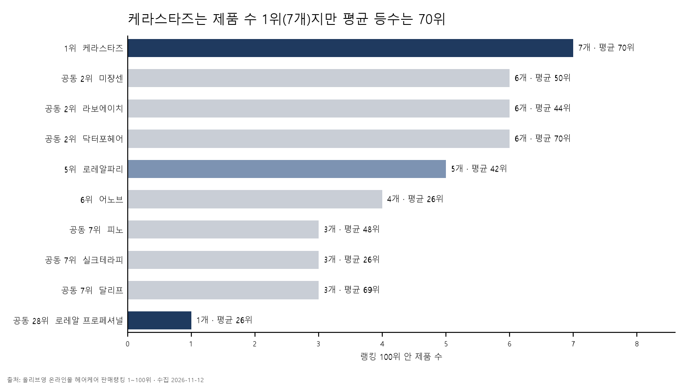
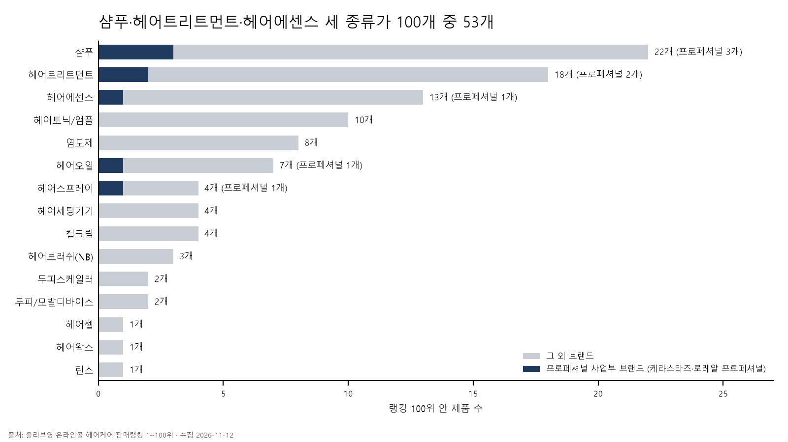
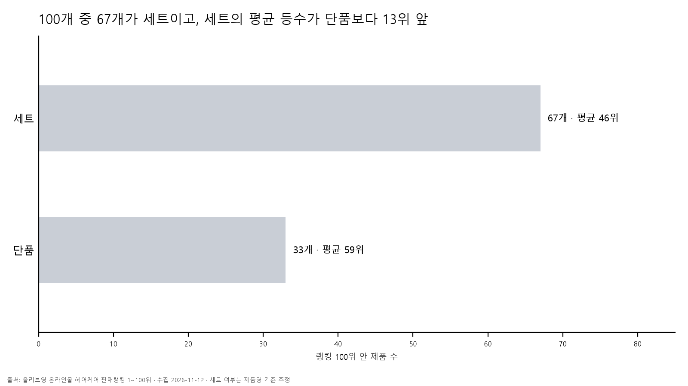
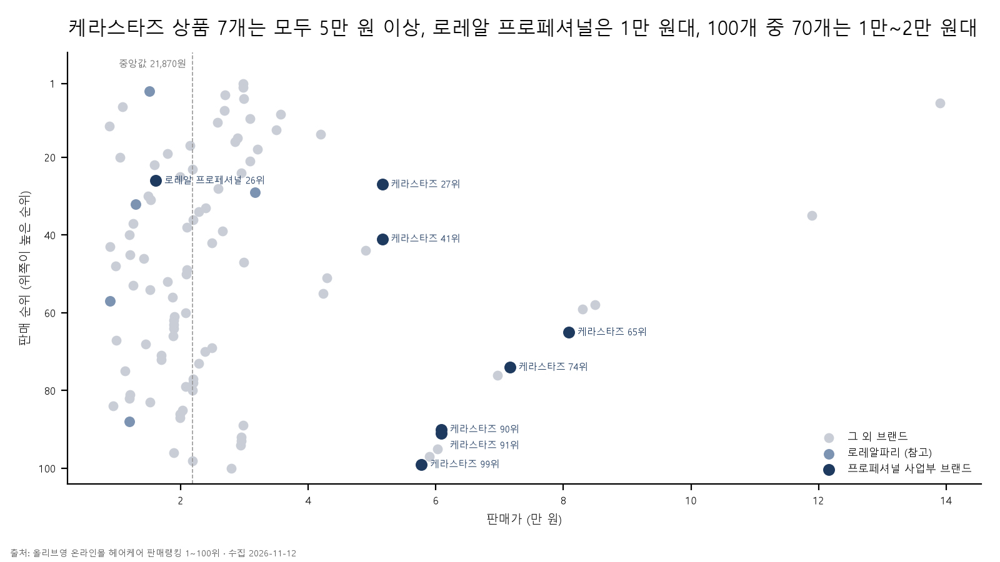
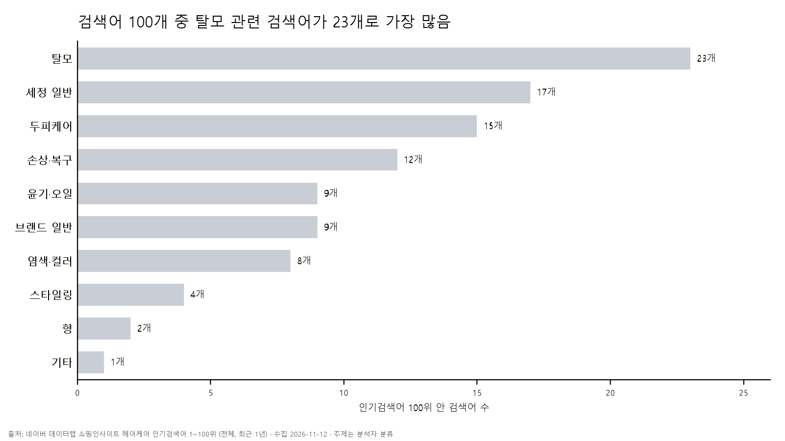
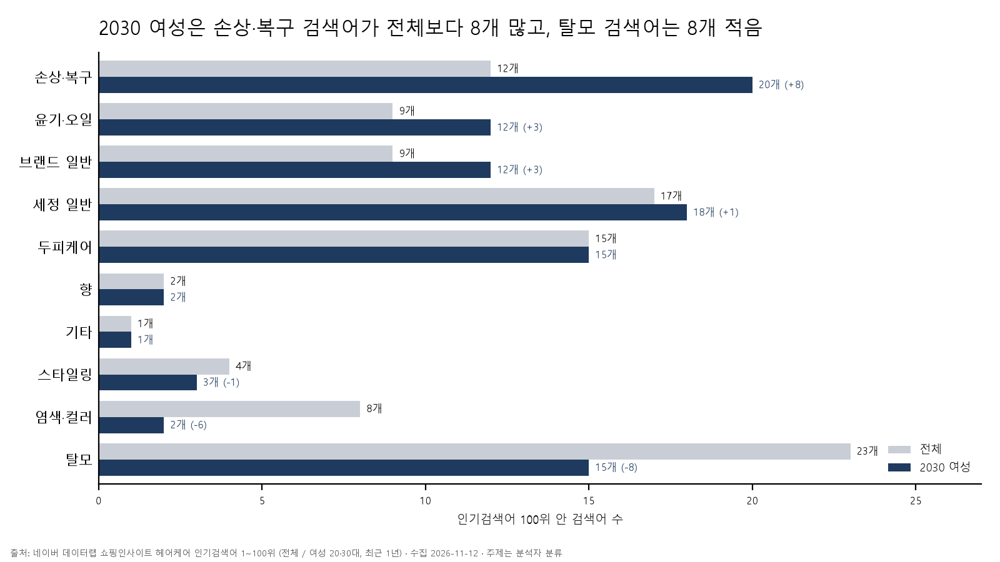
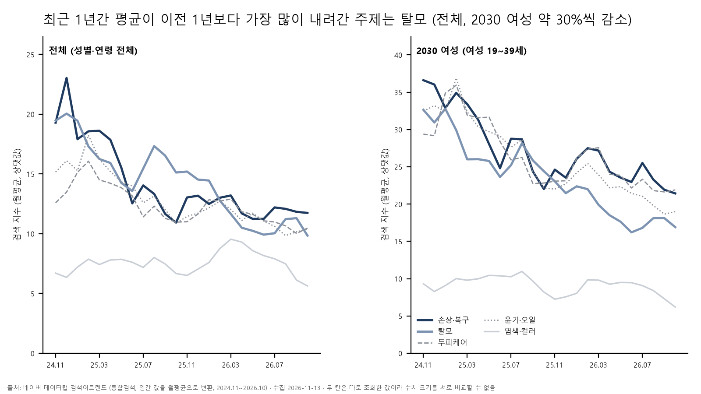

# 국내 헤어케어 트렌드 분석: 판매 랭킹 × 검색 수요 × 업계 동향
## 개요
- **목적**: 2030 여성을 타깃으로 로레알 그룹 프로페셔널 사업부의 두 브랜드(로레알 프로페셔널, 케라스타즈) 헤어 제품의 인지도를 높이는 홍보 영상을 기획함. 본 분석은 그 영상에서 어떤 제품을 어떤 메시지로 알릴지에 대한 인사이트와 근거를 시장 데이터 분석에서 얻는 것을 목표로 함.
- **배경**: 2026년 4~6월 기준 올리브영 결제추정금액의 56.5%가 30대 이하이고(와이즈앱·리테일, [메트로신문 보도](https://www.metroseoul.co.kr/article/20260729500377)), 앱 사용자의 84.6%가 여성임(와이즈앱·리테일·굿즈, 2024년 8월, [파이낸스투데이 보도](https://www.fntoday.co.kr/news/articleView.html?idxno=335063)).
- **타깃**: 올리브영 고객에서 30대 이하와 여성의 비중이 큰 점을 근거로 2030 여성으로 정함.

- **데이터**: 세 종류를 씀. 현재 판매 동향은 올리브영 헤어케어 판매랭킹 100위, 소비자의 선호와 관심도는 네이버 쇼핑인사이트 인기검색어(전체·2030 여성 각 100위)와 검색어트렌드, 업계의 방향성은 리포트·기사·공시 12건을 기준으로 파악함.
- **방법**: 데이터를 SQLite에 적재해 질문 단위로 SQL 쿼리를 작성하고, 세 데이터에서 인사이트를 도출함. 도구는 SQLite, DB Browser for SQLite, matplotlib임.
- **산출**: 질문별 결과, 얻은 인사이트, 그리고 인사이트를 근거로 한 홍보 콘셉트(제품·메시지·색감)임.

**한계**
- 올리브영 랭킹은 데이터를 조회한 시점(2026-11-12)의 순위임. 올리브영이 판매량과 매출을 공개하지 않아서 얼마나 팔렸는지는 알 수 없고, 순위가 시간에 따라 어떻게 바뀌는지도 볼 수 없다는 한계가 존재함.
- 네이버 검색 데이터는 검색 건수가 아니라 순위와 상대값임. 그래서 "몇 번 검색됐다"가 아니라 "어느 쪽이 다른 쪽보다 더 높다"로만 말할 수 있음.

**데이터 수집**
- 네 가지 데이터 모두 분석자가 직접 수집함.

| 데이터 | 수집 방법 | 조회 조건 | 수집일 |
|---|---|---|---|
| 올리브영 헤어케어 판매랭킹 | 올리브영 온라인몰의 랭킹 화면을 브라우저로 읽어 CSV로 정리 | 헤어케어 판매랭킹 1~100위 | 2026-11-12 오전 |
| 네이버 쇼핑인사이트 인기검색어 | 데이터랩 > 쇼핑인사이트 > 분야 통계 > 화장품/미용 > 헤어케어에서 직접 조회 | 최근 1년, 인기검색어 1~100위. 전체(기기·성별·연령 전체)와 2030 여성(여성, 20대·30대) 두 번 조회 | 2026-11-12 |
| 네이버 검색어트렌드 | 데이터랩 > 검색어트렌드에서 주제어 5개(탈모, 두피케어, 손상복구, 윤기오일, 염색컬러)를 한 번에 조회해 엑셀로 내려받음 | 통합검색, 일간, 2024-11-01 ~ 2026-11-12. 전체(성별·연령 전체)와 2030 여성(여성, 19~39세) 두 번 조회 | 2026-11-13 |
| 업계 동향 | 웹 검색으로 리포트·기사·공시를 찾아 한 건씩 정리 | 12건. 출처와 발행일은 [`data/industry_signals.csv`](data/industry_signals.csv)에 있음 | 2026-11-12 |

- 검색어트렌드의 주제어 5개는 인기검색어(쇼핑인사이트)에 나온 검색어 중 브랜드명이 없는 것으로 묶음. 한 주제어에 넣은 검색어는 합쳐서 하나의 값으로 조회됨.

| 주제어 | 넣은 검색어 |
|---|---|
| 탈모 | 탈모샴푸, 탈모앰플, 맥주효모샴푸, 헤어토닉 |
| 두피케어 | 두피앰플, 비듬샴푸, 지루성두피염샴푸, 두피스케일링, 약산성샴푸 |
| 손상복구 | 트리트먼트, 헤어트리트먼트, 헤어팩, 노워시트리트먼트 |
| 윤기오일 | 헤어에센스, 헤어오일, 헤어식초, 폴리쉬오일 |
| 염색컬러 | 염색샴푸, 보색샴푸, 새치염색샴푸 |

- 검색어트렌드는 일간 값을 월평균으로 바꿔 2024-11 ~ 2026-10의 24개월을 씀. 변환 과정은 [`scripts/load_nv_trend.py`](scripts/load_nv_trend.py)에 있음.
- 원본 파일은 [`data/`](data/) 폴더에 있음.

## 1. 어떤 브랜드가 상위 100순위에 있는가
**쿼리** [`sql/01_brand_share.sql`](sql/01_brand_share.sql)

**결과**
- 제품 3개 이상 차지한 브랜드 상위 9곳을 제품 수 순위대로 나타냄.
- 로레알 프로페셔널 사업부의 브랜드(케라스타즈, 로레알 프로페셔널)를 넣음. 로레알 프로페셔널은 제품 1개라 순위 밖이지만 함께 표시함.
- 평균 등수는 반올림한 값임. 전체 48개 브랜드는 [`analysis/01_brand_share.csv`](analysis/01_brand_share.csv)에 있음.

| 제품 수 순위 | 브랜드 | 제품 수 | 평균 등수 |
|---|---|---|---|
| 1위 | 케라스타즈 | 7 | 70 |
| 공동 2위 | 미쟝센 | 6 | 50 |
| 공동 2위 | 라보에이치 | 6 | 44 |
| 공동 2위 | 닥터포헤어 | 6 | 70 |
| 5위 | 로레알파리 | 5 | 42 |
| 6위 | 어노브 | 4 | 26 |
| 공동 7위 | 피노 | 3 | 48 |
| 공동 7위 | 실크테라피 | 3 | 26 |
| 공동 7위 | 달리프 | 3 | 69 |
| 공동 28위 | 로레알 프로페셔널 | 1 | 26 |

**발견**
- 100위 안에 브랜드가 48개 있고, 제품 3개 이상인 브랜드 9곳이 100개 중 43개를 차지함.
- 케라스타즈는 제품 수 1위(7개)인데 평균 등수는 70위임.
- 어노브(4개)와 실크테라피(3개)는 평균 등수가 26위임.
- 프로페셔널 사업부 브랜드는 합해서 8개임(케라스타즈 7개, 로레알 프로페셔널 1개).

### 1-1. 프로페셔널 사업부 브랜드 제품 중 어떤 제품이 몇 순위로 올라와 있는가
**왜 제품 단위까지 살펴야 할까**
- 케라스타즈는 제품 수 1위(7개)인데 평균 등수는 70위임. 7개가 어느 순위에 흩어져 있는지 알 수 없어서 제품별 순위를 따로 뽑음.
- 홍보할 제품은 로레알 그룹 프로페셔널 사업부 브랜드(로레알 프로페셔널, 케라스타즈)에서 고름. 어떤 제품이 이미 랭킹에 올라 있는지 알아야 이후 제품 선택의 근거를 댈 수 있음.

**쿼리** [`sql/01b_pro_products.sql`](sql/01b_pro_products.sql)

**결과**

| 브랜드 | 순위 | 제품명 | 소분류 | 판매가 | 세트 여부 |
|---|---|---|---|---|---|
| 로레알 프로페셔널 | 26 | [올영단독] 로레알 프로페셔널 에르네뜨 퓨어 헤어 스프레이 무향 300ml/500ml (기획/단품) | 헤어스프레이 | 16,060 | 세트 |
| 케라스타즈 | 27 | [열보호] 케라스타즈 시몽 테르미크 노워시 트리트먼트 150ml (기획/단품) | 헤어에센스 | 51,590 | 세트 |
| 케라스타즈 | 41 | 케라스타즈 샴푸 500ml 단품/기획 10종 모음 | 샴푸 | 51,590 | 세트 |
| 케라스타즈 | 65 | [NEW/리바이탈라이징] 케라스타즈 방 크로놀로지스트 샴푸 500ml | 샴푸 | 80,850 | 단품 |
| 케라스타즈 | 74 | [윤기케어] 케라스타즈 엘릭서 얼팀 헤어 오일 75ml 단품/리필 | 헤어오일 | 71,610 | 단품 |
| 케라스타즈 | 90 | 케라스타즈 헤어 마스크 200ml 단품/기획 9종 모음 | 헤어트리트먼트 | 60,830 | 세트 |
| 케라스타즈 | 91 | [플로럴부케향] 케라스타즈 글로스 압솔뤼 크림 헤어 마스크 200ml (기획/단품) | 헤어트리트먼트 | 60,830 | 세트 |
| 케라스타즈 | 99 | [지성 두피 케어] 케라스타즈 디발렁 샴푸 500ml | 샴푸 | 57,750 | 단품 |

- 세트 여부는 제품명에 기획·더블·듀오·1+1·세트·2입·증정·키트가 있으면 세트로 본 추정값임.

**발견**
- 케라스타즈 7개의 순위는 27, 41, 65, 74, 90, 91, 99위로, 50위 안은 2개이고 나머지 5개는 65위 이하임.
- 케라스타즈에서 순위가 가장 높은 제품은 시몽 테르미크 노워시 트리트먼트(27위, 헤어에센스)임.
- 케라스타즈 7개는 샴푸 3개, 헤어트리트먼트 2개, 헤어에센스 1개, 헤어오일 1개임.
- 로레알 프로페셔널은 헤어스프레이 1개(26위, 16,060원)만 올라 있음.

## 2. 어떤 종류의 제품이 상위 100순위에 있는가
**쿼리** [`sql/02_category.sql`](sql/02_category.sql)

**결과**
- 제품 종류(올리브영 소분류) 15개를 제품 수 순서대로 나타냄.
- 표의 셋째 칸은 그 종류의 제품 중 케라스타즈·로레알 프로페셔널 제품이 몇 개인지 나타냄. 예를 들어 샴푸 22개 중 3개가 케라스타즈 제품임.
- 셋째 칸의 값은 2번 쿼리가 아니라 1-1 결과(두 브랜드 제품 8개 목록)에서 가져옴.

| 제품 종류 | 제품 수 | 그중 프로페셔널 사업부 브랜드 |
|---|---|---|
| 샴푸 | 22 | 3 |
| 헤어트리트먼트 | 18 | 2 |
| 헤어에센스 | 13 | 1 |
| 헤어토닉/앰플 | 10 | 0 |
| 염모제 | 8 | 0 |
| 헤어오일 | 7 | 1 |
| 헤어스프레이 | 4 | 1 |
| 헤어세팅기기 | 4 | 0 |
| 컬크림 | 4 | 0 |
| 헤어브러쉬(NB) | 3 | 0 |
| 두피스케일러 | 2 | 0 |
| 두피/모발디바이스 | 2 | 0 |
| 헤어젤 | 1 | 0 |
| 헤어왁스 | 1 | 0 |
| 린스 | 1 | 0 |

**발견**
- 제품 종류 15개 중 샴푸 22개, 헤어트리트먼트 18개, 헤어에센스 13개로, 상위 3개 종류가 100개 중 53개를 차지함.
- 헤어토닉/앰플은 10개로 4위이고, 염모제는 8개로 5위임.
- 프로페셔널 사업부 브랜드 8개는 샴푸 3개, 헤어트리트먼트 2개, 헤어에센스 1개, 헤어오일 1개, 헤어스프레이 1개에 있음.
- 헤어토닉/앰플(10개)과 염모제(8개)에는 프로페셔널 사업부 브랜드 제품이 없음.

## 3. 세트와 단품 중 어느 쪽이 상위 100순위에 많은가
**왜 보는가**
- 순위가 높은 이유가 제품 자체인지 묶음 구성인지 구분하기 위함임. 세트가 많다면 이후 질문에서 순위를 해석할 때 이 점을 인지해야 함.

**쿼리** [`sql/03_set_vs_single.sql`](sql/03_set_vs_single.sql)

**결과**
- 세트 여부는 제품명에 기획·더블·듀오·1+1·세트·2입·증정·키트가 있으면 세트로 본 추정값임.

| 구분 | 제품 수 | 평균 등수 |
|---|---|---|
| 세트 | 67 | 46 |
| 단품 | 33 | 59 |

**발견**
- 100개 중 세트가 67개, 단품이 33개임.
- 평균 등수는 세트가 46위, 단품이 59위로, 세트가 13위 앞에 있음.
- 프로페셔널 사업부 브랜드 8개 중 5개가 세트이고 3개가 단품임.

## 4. 프로페셔널 사업부 브랜드 제품은 가격과 순위에서 어디에 있는가
**분석 이유**
- 홍보할 제품 후보를 좁히고, 프로페셔널 사업부 브랜드 제품이 경쟁사 제품과 비교해 어느 가격대, 어느 순위에 있는지 확인함.

**쿼리** [`sql/04_pro_position.sql`](sql/04_pro_position.sql)

**결과**
- 제품 100개를 판매가와 순위로 찍음. 전체 목록은 [`analysis/04_pro_position.csv`](analysis/04_pro_position.csv)에 있음.
- 아래 표는 판매가 구간별 제품 수임.

| 판매가 | 제품 수 | 그중 프로페셔널 사업부 브랜드 |
|---|---|---|
| 1만 원 미만 | 6 | 0 |
| 1만 원대 | 34 | 1 |
| 2만 원대 | 36 | 0 |
| 3만 원대 | 6 | 0 |
| 4만 원대 | 4 | 0 |
| 5만 원 이상 | 14 | 7 |

**발견**
- 100개 중 70개가 1만~2만 원대이고, 판매가 중앙값은 21,870원임.
- 케라스타즈 7개는 모두 5만 원 이상임(51,590~80,850원).
- 로레알 프로페셔널 1개는 16,060원으로 1만 원대이고 26위임.

### 4-1. 판매가 5만 원 이상인 제품은 무엇인가
**왜 보는가**
- 케라스타즈 7개가 모두 5만 원 이상이라서, 같은 가격대에 어떤 제품이 함께 있는지 확인함.

**쿼리** [`sql/04b_over_50000.sql`](sql/04b_over_50000.sql)

**결과**
- 기기 칸은 제품 종류가 두피/모발디바이스, 헤어세팅기기인 제품에 표시함.

| 순위 | 브랜드 | 제품 종류 | 판매가 | 기기 |
|---|---|---|---|---|
| 6 | 에이페 | 두피/모발디바이스 | 139,000 | 기기 |
| 27 | 케라스타즈 | 헤어에센스 | 51,590 |  |
| 35 | 펄케어 | 두피/모발디바이스 | 119,000 | 기기 |
| 41 | 케라스타즈 | 샴푸 | 51,590 |  |
| 58 | 보다나 | 헤어세팅기기 | 85,000 | 기기 |
| 59 | 보다나 | 헤어세팅기기 | 83,000 | 기기 |
| 65 | 케라스타즈 | 샴푸 | 80,850 |  |
| 74 | 케라스타즈 | 헤어오일 | 71,610 |  |
| 76 | 르네휘테르 | 헤어토닉/앰플 | 69,700 |  |
| 90 | 케라스타즈 | 헤어트리트먼트 | 60,830 |  |
| 91 | 케라스타즈 | 헤어트리트먼트 | 60,830 |  |
| 95 | 모로칸오일 | 헤어오일 | 60,300 |  |
| 97 | 휴브론 | 헤어세팅기기 | 59,000 | 기기 |
| 99 | 케라스타즈 | 샴푸 | 57,750 |  |

**발견**
- 판매가 5만 원 이상인 제품은 100개 중 14개임.
- 14개 중 기기 5개를 빼면 9개이고, 그중 7개가 케라스타즈임.
- 나머지 2개는 르네휘테르 헤어토닉/앰플(76위, 69,700원)과 모로칸오일 헤어오일(95위, 60,300원)임.

## 5. 인기 검색어는 어떤 주제에 많은가
**왜 보는가**
- 판매 랭킹은 실제 구매로 이어지는 것을, 검색어는 실제로 사람들이 찾는 것을줌. 검색어를 주제로 묶어 어떤 고민이 많은지, 어떤 것이 구매로 이어지는지 확인함.

**쿼리** [`sql/05_keyword_topic.sql`](sql/05_keyword_topic.sql)

**결과**
- 네이버 쇼핑인사이트 헤어케어 분야 인기검색어 100개(전체, 최근 1년)를 주제 10개로 나눠 셈.
- 주제는 분석자가 정한 규칙으로 분류함. 검색어에 제품 유형이나 고민이 드러나면 그 주제로, 브랜드명만 있으면 브랜드 일반으로 둠. 머리 빠짐·볼륨은 탈모, 비듬·지성·각질·진정은 두피케어로 둠.
- 검색어 수는 100위 안에 든 검색어의 개수이며 검색량이 아님.

| 주제 | 검색어 수 | 순위가 높은 검색어 예 |
|---|---|---|
| 탈모 | 23 | 탈모샴푸(6위), 그래비티샴푸(7위), 트리코닉스샴푸(9위) |
| 세정 일반 | 17 | 샴푸(1위), 로마샴푸(17위), 아모스샴푸(18위) |
| 두피케어 | 15 | 헤드앤숄더샴푸(4위), 안티트로샴푸(10위), 지루성두피염샴푸(25위) |
| 손상·복구 | 12 | 헤어트리트먼트(13위), 트리트먼트(16위), 헤드스파7(19위) |
| 윤기·오일 | 9 | 헤어에센스(3위), 모로칸오일(11위), 헤어오일(30위) |
| 브랜드 일반 | 9 | 실크테라피(8위), 케라스타즈(29위), 닥터포헤어(36위) |
| 염색·컬러 | 8 | 염색샴푸(5위), 모다모다샴푸(21위), 꾸띄르염색샴푸(44위) |
| 스타일링 | 4 | 아모스컬링에센스(2위), 아모스컬링에센스2x(28위), 컬크림(32위) |
| 향 | 2 | 헤어미스트(47위), 디올헤어미스트(77위) |
| 기타 | 1 | 리바이탈래쉬(72위) |

**발견**
- 검색어 100개 중 탈모가 23개로 가장 많고, 세정 일반 17개, 두피케어 15개, 손상·복구 12개 순임.
- 윤기·오일은 9개, 염색·컬러는 8개, 스타일링은 4개임.

## 6. 전체와 2030 여성은 검색어 주제가 어떻게 다른가
**왜 보는가**
- 5번은 전체만 봄. 2030 여성의 검색어를 전체와 나란히 놓아, 이 층이 무엇을 더 찾고 무엇을 덜 찾는지 확인함.

**쿼리** [`sql/06_keyword_segment.sql`](sql/06_keyword_segment.sql)

**결과**
- 세그먼트마다 인기검색어 100개를 주제 10개로 나눠 셈. 전체는 기기·성별·연령 전체, 2030 여성은 여성 20대와 30대임.
- 차이는 2030 여성 검색어 수에서 전체 검색어 수를 뺀 값임.
- 검색어 수는 100위 안에 든 검색어의 개수이며 검색량이 아님. 전체에는 2030 여성도 포함되어 있음.

| 주제 | 전체 | 2030 여성 | 차이 |
|---|---|---|---|
| 손상·복구 | 12 | 20 | +8 |
| 윤기·오일 | 9 | 12 | +3 |
| 브랜드 일반 | 9 | 12 | +3 |
| 세정 일반 | 17 | 18 | +1 |
| 두피케어 | 15 | 15 | 0 |
| 향 | 2 | 2 | 0 |
| 기타 | 1 | 1 | 0 |
| 스타일링 | 4 | 3 | -1 |
| 염색·컬러 | 8 | 2 | -6 |
| 탈모 | 23 | 15 | -8 |

**발견**
- 2030 여성의 손상·복구 검색어는 20개로 전체(12개)보다 8개 많고, 10개 주제 중 가장 많음.
- 2030 여성의 윤기·오일 검색어는 12개로 전체(9개)보다 3개 많음.
- 2030 여성의 탈모 검색어는 15개로 전체(23개)보다 8개 적고, 염색·컬러 검색어는 2개로 전체(8개)보다 6개 적음.
- 2030 여성의 손상·복구 검색어 20개 중 4개가 케라스타즈 관련임(케라스타즈트리트먼트 56위, 케라스타즈시몽테르미크 70위, 케라스타즈시몽 74위, 시몽테르미크 94위). 이 4개는 전체 100위에는 없음.

## 7. 주제별 검색 관심은 2년 동안 어떻게 변했는가
**왜 보는가**
- 5번과 6번은 최근 1년을 합친 한 시점의 순위임. 관심이 오르는 주제와 내리는 주제를 구분하려면 시간에 따른 변화를 봐야 함.

**쿼리** [`sql/07_topic_trend.sql`](sql/07_topic_trend.sql)

**결과**
- 네이버 검색어트렌드의 주제어 5개(탈모, 두피케어, 손상·복구, 윤기·오일, 염색·컬러)를 월 단위로 나타냄(2024-11 ~ 2026-10, 24개월). 주
- 검색 지수는 조회 기간 중 가장 높은 날을 100으로 둔 상댓값의 월평균이며 검색 건수가 아님.
- 아래 표는 이전 1년(2024-11 ~ 2025-10)과 최근 1년(2025-11 ~ 2026-10)의 평균을 비교한 값임. 24개월 전체는 [`analysis/07_topic_trend.csv`](analysis/07_topic_trend.csv)에 있음.

| 주제 | 전체: 이전 1년 | 전체: 최근 1년 | 전체: 변화 | 2030 여성: 이전 1년 | 2030 여성: 최근 1년 | 2030 여성: 변화 |
|---|---|---|---|---|---|---|
| 탈모 | 16.7 | 11.8 | -29% | 27.6 | 19.3 | -30% |
| 손상·복구 | 16.1 | 12.2 | -24% | 30.2 | 24.3 | -20% |
| 윤기·오일 | 14.4 | 11.2 | -22% | 29.9 | 21.9 | -27% |
| 두피케어 | 13.2 | 11.5 | -13% | 29.2 | 23.8 | -18% |
| 염색·컬러 | 7.3 | 7.7 | +5% | 9.7 | 8.5 | -12% |

**발견**
- 최근 1년 평균이 이전 1년보다 오른 것은 전체의 염색·컬러(+5%)뿐이고, 나머지는 모두 내려감.
- 가장 많이 내려간 주제는 탈모로, 전체 -29%, 2030 여성 -30%임.
- 2030 여성의 최근 1년 평균은 손상·복구 24.3, 두피케어 23.8, 윤기·오일 21.9, 탈모 19.3, 염색·컬러 8.5 순임.
- 2030 여성에서 탈모는 이전 1년에는 손상·복구와 2.6 차이였는데(27.6과 30.2), 최근 1년에는 5.0 차이로 벌어짐(19.3과 24.3).
- 다섯 주제가 거의 모두 내려갔으므로, 이 변화가 주제 고유의 것인지 네이버 검색 전반의 변화인지는 이 데이터로 구분할 수 없음.
